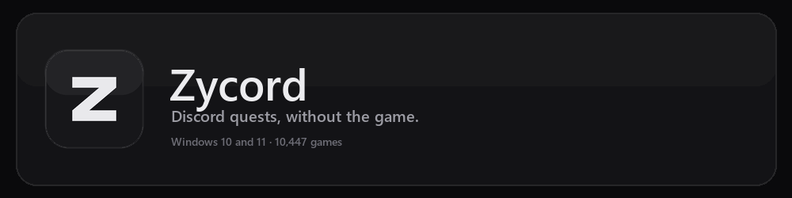
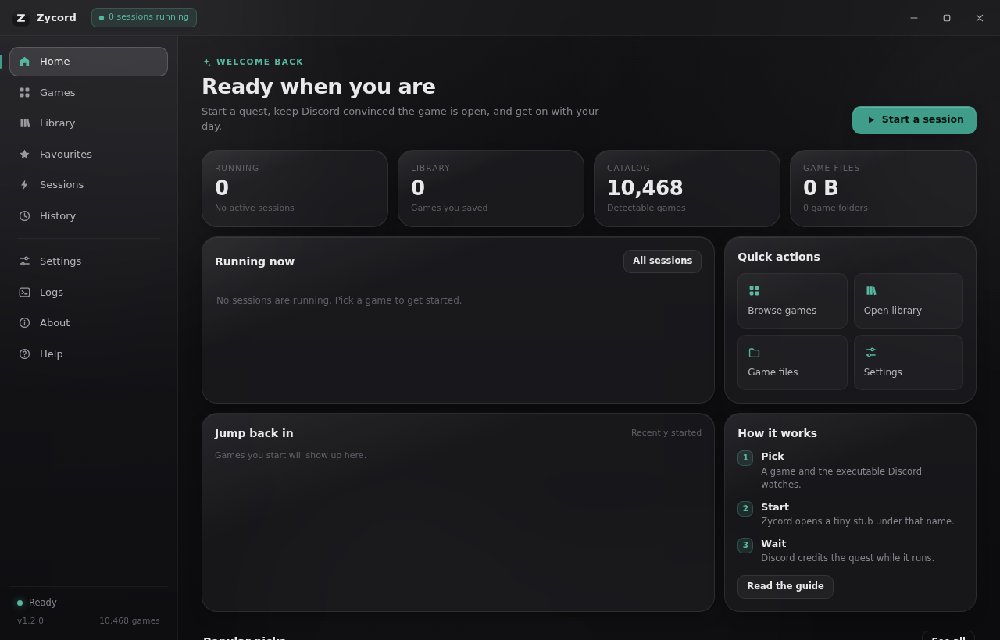
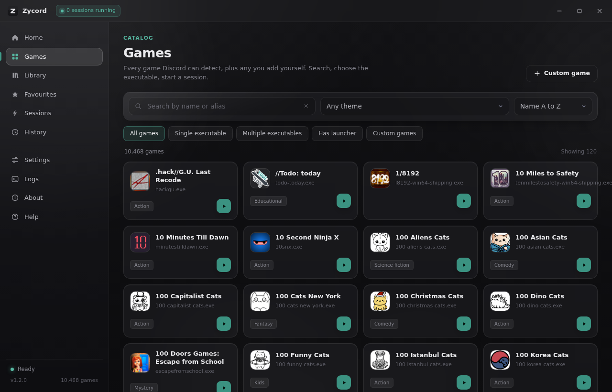
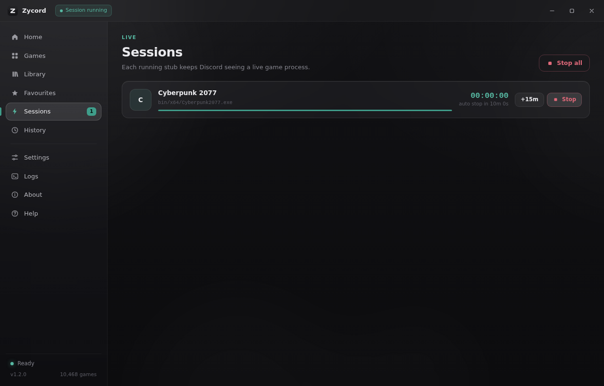
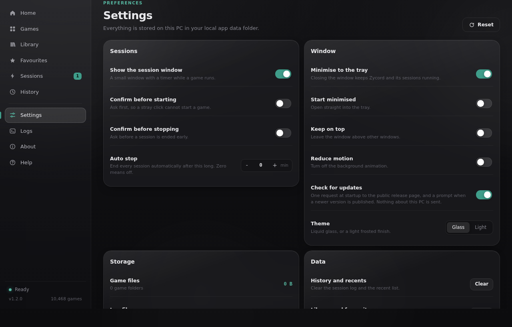
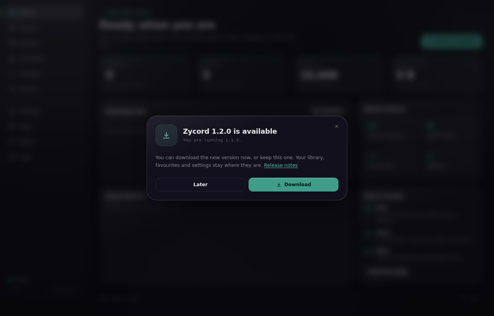

<div align="center">

<a href="https://github.com/iZynu/zycord/blob/HEAD/docs/banner.svg"></a>

**A Windows launcher that lets Discord credit desktop-play quests without launching the game.**

<a href="https://github.com/iZynu/zycord/releases/download/v2.0.0/Zycord-2.0.0.exe"></a>

<sub>One executable, 1.14 MB. Runs on Windows 10 and 11, 64-bit.</sub>

[Website](https://izynu.github.io/zycord/) | [Architecture](https://github.com/iZynu/zycord/blob/HEAD/docs/ARCHITECTURE.md) | [Changelog](https://github.com/iZynu/zycord/blob/HEAD/CHANGELOG.md) | [Issues](https://github.com/iZynu/zycord/issues)


</div>

If the animated banner or the download button does not load, use the plain links: [docs/banner.svg](https://github.com/iZynu/zycord/blob/HEAD/docs/banner.svg) and the [releases page](https://github.com/iZynu/zycord/releases).

## What it is

Zycord is a desktop application for Windows 10 and Windows 11, 64-bit. It runs a small process that Discord recognises as a registered game, so Discord credits `PLAY_ON_DESKTOP` quests while the game itself stays closed.

The launcher is a .NET Framework 4 application that hosts its interface in Microsoft Edge WebView2. It ships as a single executable with every other file embedded, installs itself into your local app data folder when you ask it to, and runs no background service.

## Why it exists

Discord quests of the desktop-play type ask you to play a game for a set time. The game must be running for the quest to advance, and Discord decides that by matching running processes against its public detectable list. For a quest worth a few cosmetics, that can mean installing a game you do not own, or leaving a large game open on a computer that cannot spare the resources.

Zycord does the part Discord checks and nothing else. It starts a process with the expected executable name in a plausible folder. It does not run the game, and it does not pretend to.

> **Before you use it.** This is not a use Discord has documented or endorsed. Quest progress gained this way can be removed, and accounts can be actioned. Zycord exists because the mechanism is simple and other tools in this space are unreliable. It does not make the practice safe. Read [docs/TERMS.md](https://github.com/iZynu/zycord/blob/HEAD/docs/TERMS.md) before you start a session.

## Features

| Area | What it does |
| --- | --- |
| Catalog | 10,468 games and 11,181 executable entries, generated from Discord's public detectable list and shipped with the application. Search by name, alias or theme, and add any game Discord does not list. A custom game appears as activity only when its file name is one Discord already lists, and the dialog says so before you add it. The 15,006 applications Discord lists without any executable are searchable too: they are not offered as games, because no process could ever match, and searching one says so instead of returning nothing. |
| Sessions | Starts one stub per game, tracked by process id, with a live timer and an optional auto stop. |
| Library | Saves a game and the executable you chose, so the next session is one click. |
| Favourites | Marks games for quick access. |
| History | Records each session with its start, stop, duration and end reason. |
| Settings | Session window, tray behaviour, confirmations, auto stop, theme, update check and storage. |
| Logs | One text file per day, with session ids, refused operations and errors. |
| Storage | Shows how much the prepared game files use and clears them on demand. |
| Updates | Optional. One request at startup to the public release page, and a prompt when a newer version exists. Nothing about the machine is sent, the check runs at most once per launch, and Settings can turn it off. |

The interface has ten sections: Home, Games, Library, Favourites, Sessions, History, Settings, Logs, About and Help.

## How it works

1. You choose a game and an executable in the Games tab.
2. Zycord validates the executable entry: no absolute paths, no drive letters, no `..`, and a target Windows starts as a program (`.exe`, `.bin`, `.dat`, `.dll`, `.des`, `.jbg`, `.game` or `.pae`).
3. It copies `stub.exe` (about 36 KB) to `%LOCALAPPDATA%\Zycord\games\<app_id>\<relative exe path>` and starts it.
4. Discord matches the running process against its detectable list and treats the game as running, which is what desktop-play quests key off. A file name that is not on that list cannot match, so a custom game with an invented name runs but never appears as activity.
5. A typical quest needs about 15 minutes. Leave the session running, then stop it.
6. Stopping confirms the process still points at the file Zycord created before terminating it, so a real game with the same name is never touched.

The stub contains no game code and no network code. It never contacts Discord. The full design is in [docs/ARCHITECTURE.md](https://github.com/iZynu/zycord/blob/HEAD/docs/ARCHITECTURE.md).

## Screenshots



| Games | Sessions | Settings | Update prompt |
| --- | --- | --- | --- |
|  |  |  |  |

## Install

Windows 10 or 11, 64-bit. No administrator rights, no account, no runtime to install first.

1. **Download.** Use the button above, or take `Zycord-2.0.0.exe` from the [releases page](https://github.com/iZynu/zycord/releases). It is the executable itself — no archive to unpack.
2. **A single file.** `Zycord-2.0.0.exe` is 1.14 MB and self-contained: the interface, the game catalog and the WebView2 assemblies are all inside it. Rename it to `Zycord.exe` if you prefer.
3. **Run it.** Double-click the downloaded file. Windows may ask for confirmation before running a file from the internet; choose Run.
4. **Choose Install** when Zycord asks. It copies itself to `%LOCALAPPDATA%\Zycord\app`, adds a **Start Menu shortcut** and an entry in **Add or remove programs**, then opens. Choosing **No** runs it once without installing, which is fine for a quick look but leaves you updating by hand.
5. **SmartScreen.** Windows will warn that the publisher is unknown, because the executable is not signed with a code-signing certificate. Choose **More info**, then **Run anyway**.

After that you launch Zycord from the Start Menu. **You never need the downloaded file again.**

### Updating

When a new release is published, Zycord shows an **Update available** prompt on its next launch. Press **Download** and it:

- downloads the release archive,
- checks it against the SHA-256 checksum the release publishes, and refuses it if they differ,
- asks before installing, then restarts into the new version.

Your library, favourites, settings and history are kept. You can also check on demand: **About → Check for updates**.

### Uninstalling

**Settings → Uninstall**, then confirm. It removes the program files, the Start Menu shortcut, the Add or remove programs entry and the data folder at `%LOCALAPPDATA%\Zycord` — settings, logs and prepared game files included. Stop any running sessions first.

If you ran Zycord without installing, there is nothing to uninstall: delete the `Zycord.exe` file and, if you want the data gone too, delete `%LOCALAPPDATA%\Zycord`.

## Build from source

You need Windows 10 or 11, 64-bit, the .NET Framework 4 compiler that ships with Windows, and Python 3. No Visual Studio, .NET SDK, MSBuild or NuGet restore is required.

```bash
git clone https://github.com/iZynu/zycord.git
cd zycord
python build.py
```

The script compiles the stub and the launcher, copies the interface and the WebView2 assemblies into `dist/`, runs the self test, and produces `Zycord-2.0.0.exe`, `Zycord-2.0.0.zip` plus `SHA256.txt`.

| Command | What it does |
| --- | --- |
| `python build.py` | Build, run the self test, pack the release. |
| `python build.py --no-test` | Build and pack without the self test. |
| `python build.py --no-zip` | Leave `dist/` unpacked. |
| `python build.py --clean` | Remove `dist/` first. |

The self test boots the real interface in a hidden window, checks path validation against hostile input, round trips settings and the library, starts and stops a real session, and writes a report to `%LOCALAPPDATA%\Zycord\logs\selftest.txt`. A passing run ends with `RESULT: PASS` and exit code 0.

## Project layout

```text
zycord/
  app/
    main/          C# launcher: window, bridge, sessions, settings, self test
    renderer/      HTML, CSS and JavaScript interface
    assets/        catalog.json.gz, the catalog used at build time
  stub/            Stub.cs, the session stub source
  brand/           make_icon.py and the generated icon set
  site/            build_site.py and the static site
  docs/            banner, screenshots, architecture, privacy, terms
  scripts/         build_catalog.py
  build.py         build, self test and packaging
```

## FAQ

### Is this safe for my Discord account?

No tool can promise that. Discord has not documented or endorsed this use, progress can be removed, and accounts have been actioned for automating quests. What Zycord avoids is the riskier behaviour of older tools: it does not run a self-bot, does not connect to Discord's gateway, does not read or store a token, and does not modify the Discord client.

### Do I need the game installed?

No. Zycord creates a process with the executable name Discord watches, not the game itself.

### Does it need my Discord login?

No. There is no sign-in, no token and no stored credential.

### Does it work if Discord is closed?

No. Discord must be running on the same computer to detect the process and credit quest progress.

### Why is the catalog fixed instead of downloaded?

A launcher that fetches its data at startup has to trust whoever serves it, and depends on a server staying online. The catalog is generated at build time and shipped with the application, so it never depends on a server, and it is not downloaded when you open the launcher. The trade-off is that games added to Discord's list after a release will not appear until the next release ships with an updated catalog.

### How does it know when a new version is out?

The launcher asks the public release page for this repository once at startup, compares the newest published version with the one it is running, and shows a prompt when there is something newer. The prompt appears once per release, not on every launch. Downloading is a normal link to the release archive, so nothing is installed behind your back. Turn the check off in Settings and no request is made at all; the About tab can still check on demand.

### Why does Windows SmartScreen warn me?

The executable is not signed. Code-signing certificates cost money and identify a legal entity, which this project does not have. Choose More info and then Run anyway, or build from source and inspect it yourself.

### Will it stop my real game?

No. Zycord records the process id it started and, before stopping anything, confirms the process still points at the file Zycord created. It never stops by image name.

### How much disk does it use?

About 3.1 MB for the application, plus about 36 KB for each prepared game. The Settings tab shows the exact figure and clears it on demand.

## Privacy

Zycord collects nothing. There is no analytics, no crash reporting and no server. Settings, logs and prepared game files live in `%LOCALAPPDATA%\Zycord`. The application never asks for Discord credentials and never contacts Discord.

The update check is the one exception to "no network", and it is visible: when it is on, the launcher makes a single HTTPS request to the public GitHub release page for this repository, reads the newest version number, and shows a prompt if it is newer than the build you are running. The request carries no identifier, no account and no session data, and turning it off in Settings stops it entirely. The catalog is not downloaded; it ships inside the application.

The full policy is in [docs/PRIVACY.md](https://github.com/iZynu/zycord/blob/HEAD/docs/PRIVACY.md), and on the website at [izynu.github.io/zycord/privacy.html](https://izynu.github.io/zycord/privacy.html).

## License

Zycord is released under the MIT License. See [LICENSE](LICENSE).

## Contributing

Contributions are welcome. Read [CONTRIBUTING.md](https://github.com/iZynu/zycord/blob/HEAD/CONTRIBUTING.md) for the build, the self test, code style and what will not be accepted. Report bugs and request features through the [issue templates](https://github.com/iZynu/zycord/issues/new/choose). Report security problems privately, as described in [SECURITY.md](https://github.com/iZynu/zycord/blob/HEAD/SECURITY.md).

Zycord is an independent project. It is not affiliated with, endorsed by, or sponsored by Discord Inc.
