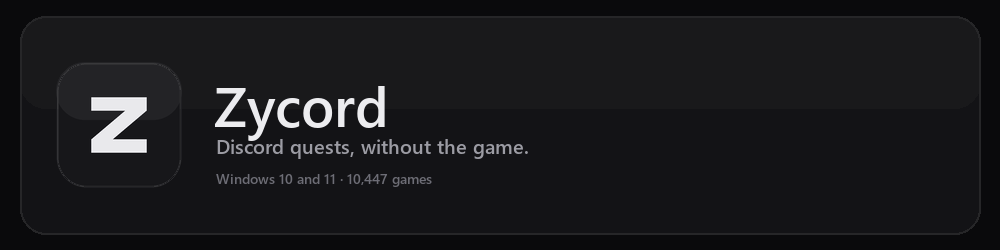
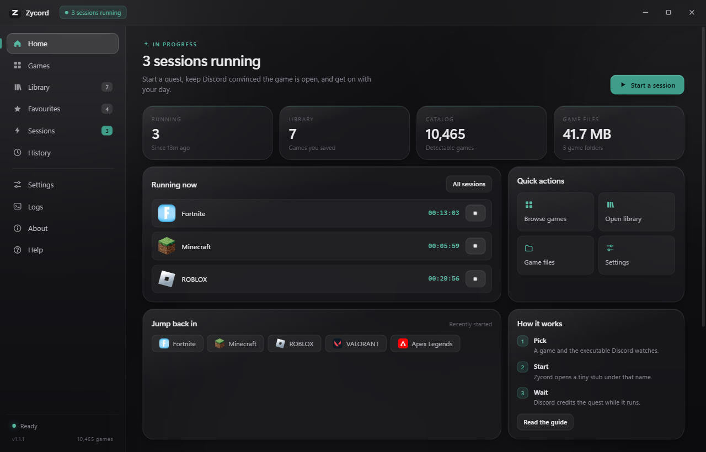
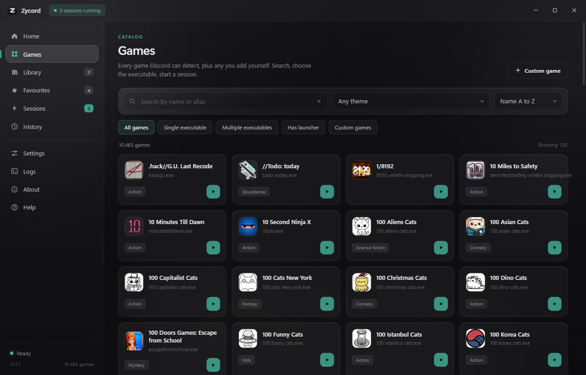
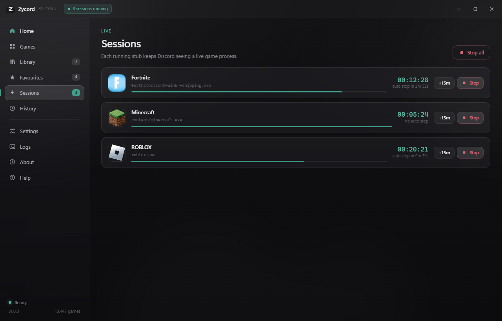
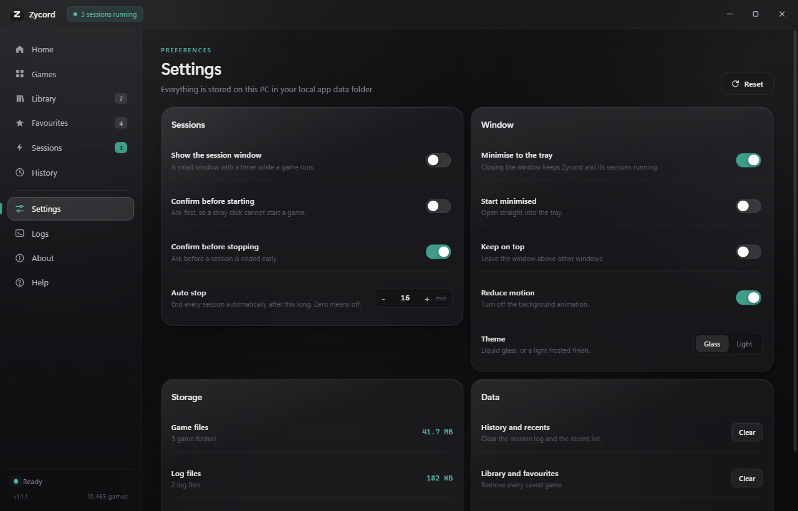

<div align="center">

<a href="docs/banner.svg"></a>

**A Windows launcher that lets Discord credit desktop-play quests without launching the game.**

[Download 1.1.2](https://github.com/iZynu/zycord/releases/download/v1.1.2/Zycord-1.1.2.zip) | [Website](https://izynu.github.io/zycord/) | [Architecture](docs/ARCHITECTURE.md) | [Issues](https://github.com/iZynu/zycord/issues)


</div>

If the animated banner does not load, open [docs/banner.svg](docs/banner.svg).

## What it is

Zycord is a desktop application for Windows 10 and Windows 11, 64-bit. It runs a small process that Discord recognises as a registered game, so Discord credits `PLAY_ON_DESKTOP` quests while the game itself stays closed.

The launcher is a .NET Framework 4 application that hosts its interface in Microsoft Edge WebView2. It ships as one folder with no installer, no background service, no account and no server.

## Why it exists

Discord quests of the desktop-play type ask you to play a game for a set time. The game must be running for the quest to advance, and Discord decides that by matching running processes against its public detectable list. For a quest worth a few cosmetics, that can mean installing a game you do not own, or leaving a large game open on a computer that cannot spare the resources.

Zycord does the part Discord checks and nothing else. It starts a process with the expected executable name in a plausible folder. It does not run the game, and it does not pretend to.

> **Before you use it.** This is not a use Discord has documented or endorsed. Quest progress gained this way can be removed, and accounts can be actioned. Zycord exists because the mechanism is simple and other tools in this space are unreliable. It does not make the practice safe. Read [docs/TERMS.md](docs/TERMS.md) before you start a session.

## Features

| Area | What it does |
| --- | --- |
| Catalog | 10,465 games and 11,171 executable entries, generated from Discord's public detectable list and shipped with the application. Search by name, alias or theme, and add any game Discord does not list. A custom game appears as activity only when its file name is one Discord already lists, and the dialog says so before you add it. |
| Sessions | Starts one stub per game, tracked by process id, with a live timer and an optional auto stop. |
| Library | Saves a game and the executable you chose, so the next session is one click. |
| Favourites | Marks games for quick access. |
| History | Records each session with its start, stop, duration and end reason. |
| Settings | Session window, tray behaviour, confirmations, auto stop, theme and storage. |
| Logs | One text file per day, with session ids, refused operations and errors. |
| Storage | Shows how much the prepared game files use and clears them on demand. |

The interface has ten sections: Home, Games, Library, Favourites, Sessions, History, Settings, Logs, About and Help.

## How it works

1. You choose a game and an executable in the Games tab.
2. Zycord validates the executable entry: no absolute paths, no drive letters, no `..`, and a target Windows starts as a program (`.exe`, `.bin`, `.dat`, `.dll`, `.des`, `.jbg`, `.game` or `.pae`).
3. It copies `stub.exe` (about 35 KB) to `%LOCALAPPDATA%\Zycord\games\<app_id>\<relative exe path>` and starts it.
4. Discord matches the running process against its detectable list and treats the game as running, which is what desktop-play quests key off. A file name that is not on that list cannot match, so a custom game with an invented name runs but never appears as activity.
5. A typical quest needs about 15 minutes. Leave the session running, then stop it.
6. Stopping confirms the process still points at the file Zycord created before terminating it, so a real game with the same name is never touched.

The stub contains no game code and no network code. It never contacts Discord. The full design is in [docs/ARCHITECTURE.md](docs/ARCHITECTURE.md).

## Screenshots



| Games | Sessions | Settings |
| --- | --- | --- |
|  |  |  |

## Install

1. Download `Zycord-1.1.2.zip` from the [releases page](https://github.com/iZynu/zycord/releases).
2. Extract it to a folder you can write to, for example `C:\Users\you\Apps\Zycord`.
3. Run `Zycord.exe`.
4. If Windows shows a SmartScreen warning, choose More info and then Run anyway. The executable is not signed with a code-signing certificate.
5. If the WebView2 Runtime is missing, install the Evergreen Runtime from Microsoft and run Zycord again. It ships with Windows 11 and with current Windows 10 updates.

No administrator rights are needed. To uninstall, stop any sessions, delete the extracted folder, then delete `%LOCALAPPDATA%\Zycord` to remove settings, logs and prepared game files.

## Build from source

You need Windows 10 or 11, 64-bit, the .NET Framework 4 compiler that ships with Windows, and Python 3. No Visual Studio, .NET SDK, MSBuild or NuGet restore is required.

```bash
git clone https://github.com/iZynu/zycord.git
cd zycord
python build.py
```

The script compiles the stub and the launcher, copies the interface and the WebView2 assemblies into `dist/`, runs the self test, and produces `Zycord-1.1.2.zip` plus `SHA256.txt`.

| Command | What it does |
| --- | --- |
| `python build.py` | Build, run the self test, pack the release. |
| `python build.py --no-test` | Build and pack without the self test. |
| `python build.py --no-zip` | Leave `dist/` unpacked. |
| `python build.py --clean` | Remove `dist/` first. |

The self test boots the real interface in a hidden window, checks path validation against hostile input, round trips settings and the library, starts and stops a real session, and writes a report to `%LOCALAPPDATA%\Zycord\logs\selftest.txt`. A passing run ends with `RESULT: PASS` and exit code 0.

## Project layout

```text
zycord/
  app/
    main/          C# launcher: window, bridge, sessions, settings, self test
    renderer/      HTML, CSS and JavaScript interface
    assets/        catalog.json.gz, the catalog used at build time
  stub/            Stub.cs, the session stub source
  brand/           make_icon.py and the generated icon set
  site/            build_site.py and the static site
  docs/            banner, screenshots, architecture, privacy, terms
  scripts/         build_catalog.py
  build.py         build, self test and packaging
```

## FAQ

### Is this safe for my Discord account?

No tool can promise that. Discord has not documented or endorsed this use, progress can be removed, and accounts have been actioned for automating quests. What Zycord avoids is the riskier behaviour of older tools: it does not run a self-bot, does not connect to Discord's gateway, does not read or store a token, and does not modify the Discord client.

### Do I need the game installed?

No. Zycord creates a process with the executable name Discord watches, not the game itself.

### Does it need my Discord login?

No. There is no sign-in, no token and no stored credential.

### Does it work if Discord is closed?

No. Discord must be running on the same computer to detect the process and credit quest progress.

### Why is the catalog fixed instead of downloaded?

A launcher that fetches its data at startup has to trust whoever serves it, and depends on a server staying online. The catalog is generated at build time and shipped with the application, so it never depends on a server. The only network request the interface makes is for game icons from Discord's CDN. The trade-off is that games added to Discord's list after a release will not appear until the next release ships with an updated catalog.

### Why does Windows SmartScreen warn me?

The executable is not signed. Code-signing certificates cost money and identify a legal entity, which this project does not have. Choose More info and then Run anyway, or build from source and inspect it yourself.

### Will it stop my real game?

No. Zycord records the process id it started and, before stopping anything, confirms the process still points at the file Zycord created. It never stops by image name.

### How much disk does it use?

About 3.1 MB for the application, plus about 35 KB for each prepared game. The Settings tab shows the exact figure and clears it on demand.

## Privacy

Zycord collects nothing. There is no analytics, no crash reporting, no update check and no server. Settings, logs and prepared game files live in `%LOCALAPPDATA%\Zycord`. The application never asks for Discord credentials and never contacts Discord.

The full policy is in [docs/PRIVACY.md](docs/PRIVACY.md), and on the website at [izynu.github.io/zycord/privacy.html](https://izynu.github.io/zycord/privacy.html).

## License

Zycord is released under the MIT License. See [LICENSE](LICENSE).

## Contributing

Contributions are welcome. Read [CONTRIBUTING.md](CONTRIBUTING.md) for the build, the self test, code style and what will not be accepted. Report bugs and request features through the [issue templates](https://github.com/iZynu/zycord/issues/new/choose). Report security problems privately, as described in [SECURITY.md](SECURITY.md).

Zycord is an independent project. It is not affiliated with, endorsed by, or sponsored by Discord Inc.
